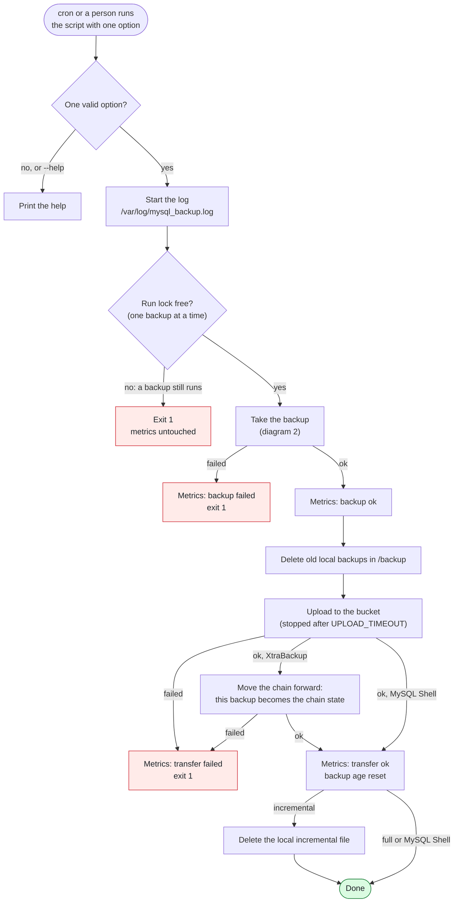
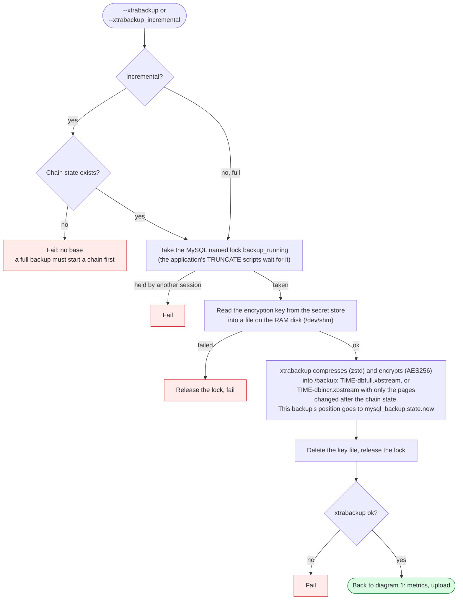
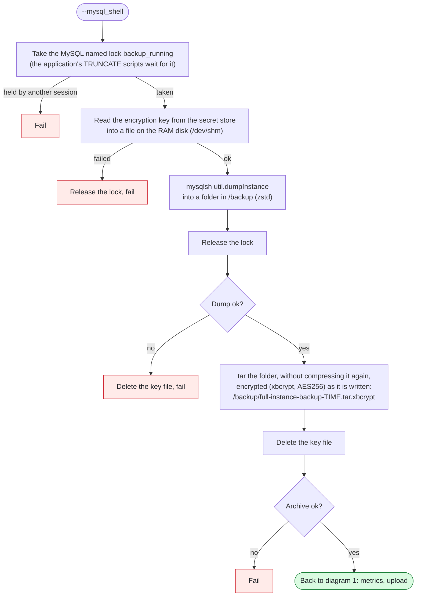
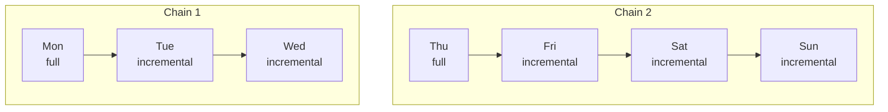

# MySQL backup script: workflow

How [`mysql_backup_v3.sh`](mysql_backup_v3.sh) (GCP) and [`mysql_backup_v3_aws.sh`](mysql_backup_v3_aws.sh) (AWS) work: the same logic, with different cloud commands. The diagrams leave the cloud out: **bucket** is the GCS or S3 bucket, and **secret store** is where the encryption key is kept (GCP Secret Manager or AWS Secrets Manager).

| Option | What it does |
|---|---|
| `--xtrabackup` | A full backup with XtraBackup, compressed, encrypted and uploaded to the bucket. It starts a new incremental chain. |
| `--xtrabackup_incremental` | Only the pages changed since the last backup of the chain, compressed, encrypted and uploaded. |
| `--mysql_shell` | A logical dump with MySQL Shell: its archive is encrypted and uploaded to the bucket. |
| `--xtrabackup_local`, `--mysql_shell_local` | Only the backup step (diagram 2): the backup stays in `/backup`, with no upload and no metrics. |

## 1. One run

Red: the run ends with exit 1.



## 2. The backup step

XtraBackup, full and incremental. Each fail goes back to diagram 1 as "failed":



MySQL Shell. Each fail also goes back to diagram 1 as "failed":



If the script is interrupted during a backup, a trap deletes the key file and releases the lock. The key is never printed or written to the log.

## 3. The incremental chain



- Each incremental holds only the pages changed since the backup before it. After its upload, a backup's position (`xtrabackup_checkpoints`) becomes the **chain state** in `/opt/scripts/mysql_backup.state`: the base of the next incremental.
- A failed backup or upload leaves the chain state on the last backup in the bucket, so the next incremental continues from there: the chain has no holes.
- A full backup starts a new chain. [The cron example](#cron) takes fulls on Monday and Thursday, and incrementals on the other days.
- To restore Saturday: Thursday's full, then Friday's and Saturday's incrementals, in this order. [`mysql_restore_v2.sh`](../mysql_restore_script/mysql_restore_v2.sh) (AWS: [`mysql_restore_v2_aws.sh`](../mysql_restore_script/mysql_restore_v2_aws.sh)) does this. It also deletes the chain state, because an incremental taken on top of the old chain after a restore would miss changes without any error. Incrementals then fail until a full backup starts a new chain. It deletes the binlog chain state as well, for the same reason (see [the binlog workflow](mysql_binlog_backup_workflow.md)).
- After the restore, MySQL is closed to clients until a person runs `systemctl restart mysqld`, so nothing can write before the checks or a binlog replay.
- For a moment later than the backup: `--fetch_binlogs <server>` in the restore script fetches the binlogs from the position the data reached and prints how to replay them. A DBA replays them by hand, up to the chosen moment. [The restore workflow](../mysql_restore_script/mysql_restore_workflow.md) has the steps.
- Retention: to restore any moment of the last N days, keep every backup N + 4 days. A restore point can need a full backup up to 4 days older than itself (Thursday's full, three incrementals and a day of binlogs).

## Cron

`/etc/cron.d/mysql_backup`, for fulls on Monday and Thursday and incrementals on the other days (on AWS, `mysql_backup_v3_aws.sh`):

```
PATH=/usr/local/sbin:/usr/local/bin:/usr/sbin:/usr/bin:/sbin:/bin
0 2 * * 1,4 root /opt/scripts/mysql_backup_v3.sh --xtrabackup > /dev/null 2>&1
0 2 * * 0,2,3,5,6 root /opt/scripts/mysql_backup_v3.sh --xtrabackup_incremental > /dev/null 2>&1
```

- **`PATH`:** cron's own is short, and the script finds the cloud CLI with `which`. Without it, a CLI in `/usr/local/bin` looks not installed and the backup fails.
- **Take the first full by hand before enabling it:** `/opt/scripts/mysql_backup_v3.sh --xtrabackup`. Otherwise every incremental fails with "No base" until the next Monday or Thursday.
- **The output:** the script logs itself to `/var/log/mysql_backup.log`, so cron's copy goes to `/dev/null`.
- **The file:** owned by root, mode 644, ending with a new line, and with no dot in its name, or cron ignores it. The script needs `chmod 700`.
- **The time:** the server's local time.
- **Long backups:** a run that finds another still running fails, with its metrics untouched. A full that takes over 24 hours makes the next incremental fail.
- **MySQL Shell:** `--mysql_shell` is not in the example. If you schedule it, pick a time that doesn't overlap the XtraBackup runs, for the same reason.

The binlogs have [their own cron file](mysql_binlog_backup_workflow.md#cron).

## What it writes

| Where | What |
|---|---|
| Bucket | `TIME-dbfull.xbstream`, `TIME-dbincr.xbstream` and `full-instance-backup-TIME.tar.xbcrypt` (MySQL Shell), all encrypted |
| `/backup` | Recent backups for a quick restore: XtraBackup files are deleted after 23 hours, MySQL Shell archives after 3 days, and the MySQL Shell dump folder (not encrypted) after a day or two. Incrementals are deleted right after their upload. |
| `/opt/scripts/mysql_backup.state` | The chain state: the position of the last backup in the bucket |
| `/var/log/mysql_backup.log` | Every run, with colors (`less -R`) |
| node_exporter textfile folder | `node_mysql_backup_*` (full and MySQL Shell) and `node_mysql_incremental_backup_*`: status, durations, time of the last success |
