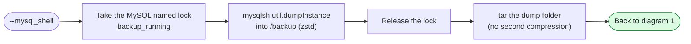
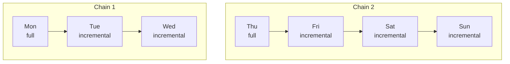

# MySQL backup script: workflow

How [`mysql_backup_v3_aws.sh`](mysql_backup_v3_aws.sh) works. The diagrams leave the cloud out: **bucket** is the S3 or GCS bucket, and **secret store** is where the encryption key is kept (AWS Secrets Manager today). The GCP script [`mysql_backup_v3.sh`](mysql_backup_v3.sh) follows the same flow, and gets encryption and incremental backups when they are ported.

| Option | What it does |
|---|---|
| `--xtrabackup` | A full backup with XtraBackup, compressed, encrypted and uploaded to the bucket. It starts a new incremental chain. |
| `--xtrabackup_incremental` | Only the pages changed since the last backup of the chain, compressed, encrypted and uploaded. |
| `--mysql_shell` | A logical dump with MySQL Shell, uploaded (not encrypted). |
| `--xtrabackup_local`, `--mysql_shell_local` | Only the backup step (diagram 2): the backup stays in `/backup`, with no upload and no metrics. |

## 1. One run

Red: the run ends with exit 1.

## 2. The backup step

XtraBackup, full and incremental. Each fail goes back to diagram 1 as "failed":

If the script is stopped or killed during the backup, a trap deletes the key file and releases the lock. The key is never printed or written to the log.

MySQL Shell:

## 3. The incremental chain

- Each incremental holds only the pages changed since the backup before it. After its upload, a backup's position (`xtrabackup_checkpoints`) becomes the **chain state** in `/opt/scripts/mysql_backup.state`: the base of the next incremental.
- A failed backup or upload leaves the chain state on the last backup in the bucket, so the next incremental continues from there: the chain has no holes.
- A full backup starts a new chain. The cron example in the script header takes fulls on Monday and Thursday, and incrementals on the other days.
- To restore Saturday: Thursday's full, then Friday's and Saturday's incrementals, in this order (and the binlogs for a later moment). [`mysql_restore_v2_aws.sh`](../mysql_restore_script/mysql_restore_v2_aws.sh) does this. It also deletes the chain state, because an incremental taken on top of the old chain after a restore would miss changes without any error. Incrementals then fail until a full backup starts a new chain.
- Retention: to restore any moment of the last N days, keep every backup N + 4 days. A restore point can need a full backup up to 4 days older than itself (Thursday's full, three incrementals and a day of binlogs).

## What it writes

| Where | What |
|---|---|
| Bucket | `TIME-dbfull.xbstream` and `TIME-dbincr.xbstream` (encrypted), `full-instance-backup-TIME.tar` (MySQL Shell) |
| `/backup` | Recent backups for a quick restore: XtraBackup files are deleted after 23 hours, MySQL Shell archives after 3 days. Incrementals are deleted right after their upload. |
| `/opt/scripts/mysql_backup.state` | The chain state: the position of the last backup in the bucket |
| `/var/log/mysql_backup.log` | Every run, with colors (`less -R`) |
| node_exporter textfile folder | `node_mysql_backup_*` (full and MySQL Shell) and `node_mysql_incremental_backup_*`: status, durations, time of the last success |
