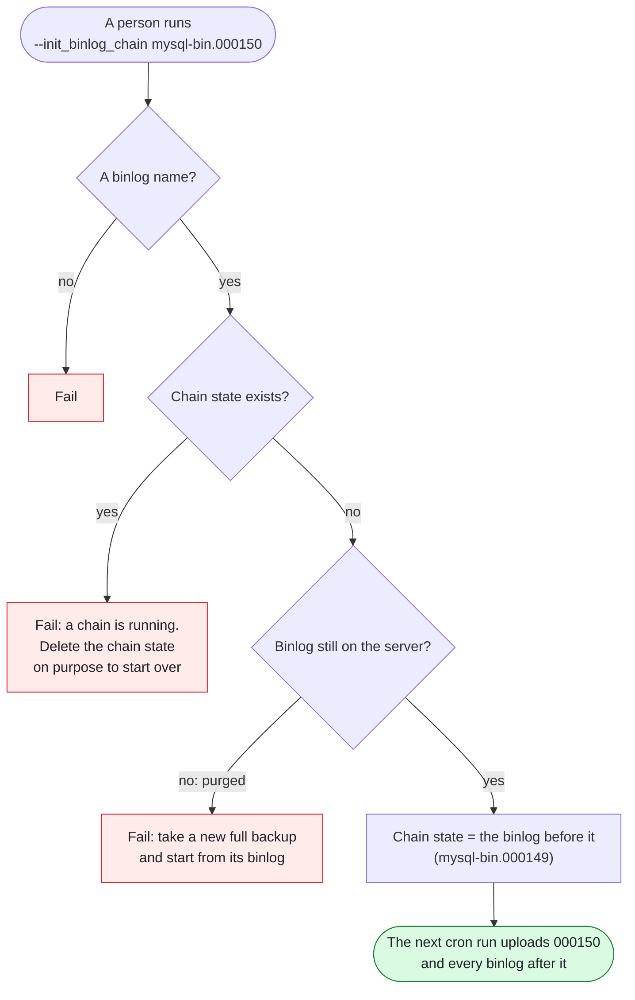
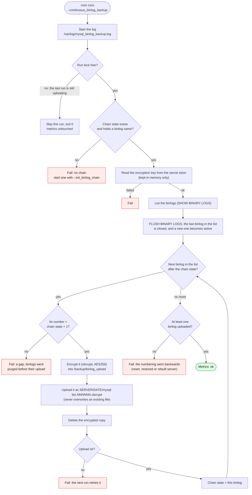

# MySQL binlog backup script: workflow

How [`mysql_binlog_backup_v2_aws.sh`](mysql_binlog_backup_v2_aws.sh) works. The diagrams leave the cloud out: **bucket** is the S3 or GCS bucket, and **secret store** is where the encryption key is kept (AWS Secrets Manager today). The GCP script [`mysql_binlog_backup_v2.sh`](mysql_binlog_backup_v2.sh) follows the same flow, and gets encryption when it is ported.

| Option | What it does |
|---|---|
| `--init_binlog_chain mysql-bin.NNNNNN` | Starts a binlog chain, once, by hand. It uploads nothing itself. `--help` shows which binlog to start from. |
| `--continuous_binlog_backup` | From cron every 15-30 minutes: encrypts every closed binlog of the chain and uploads it to the bucket. |

## 1. Starting a chain (once, by hand)

The **chain state** (`/opt/scripts/mysql_binlog_backup.state`) always holds the last binlog in the bucket.

## 2. Every cron run

Red: the run ends with the metrics set to failed and exit 1. A failed MySQL command or encryption ends it the same way.

An example run. The chain state holds `mysql-bin.000041`; the server has `000040` to `000044`, and `000044` is active:

1. The list is `000040` to `000044`. FLUSH closes `000044`, and `000045` becomes the active binlog.
2. `000040` and `000041` are already in the bucket: skipped.
3. `000042`, `000043` and `000044` are encrypted and uploaded, one at a time. After each upload, the chain state moves to it.
4. The chain state holds `000044`. The next run starts from `000045`.

- **A gap** (a missing binlog number) means MySQL purged binlogs before they were uploaded (`binlog_expire_logs_seconds`). Point-in-time recovery cannot cross it, so every run fails until a person takes a new full backup and starts a new chain from that backup's binlog.
- **No upload at all** means the numbering went backwards (`RESET BINARY LOGS AND GTIDS`, a restored or rebuilt server): a new full backup and a new chain. `--help` lists which binlog to start from in each case.
- Each server has its own folder in the bucket, and an upload never overwrites a file: a binlog with the same name from another sequence makes the upload fail instead.
- Retention: keep the binlogs as long as the full backups (N + 4 days, see [the backup workflow](mysql_backup_workflow.md)).

## What it writes

| Where | What |
|---|---|
| Bucket | `SERVER/DATE/mysql-bin.NNNNNN.xbcrypt` (encrypted) |
| `/backup/binlog_upload` | One encrypted binlog during its upload, deleted after it |
| `/opt/scripts/mysql_binlog_backup.state` | The chain state: the last binlog in the bucket |
| `/var/log/mysql_binlog_backup.log` | Every run, with colors (`less -R`) |
| node_exporter textfile folder | `node_mysql_binlog_backup_status` (0 ok, 1 failed), `node_mysql_binlog_backup_duration_seconds`, `node_mysql_current_active_binlog`, `node_mysql_last_backed_up_binlog`, `node_mysql_last_successful_binlog_backup_date` |
