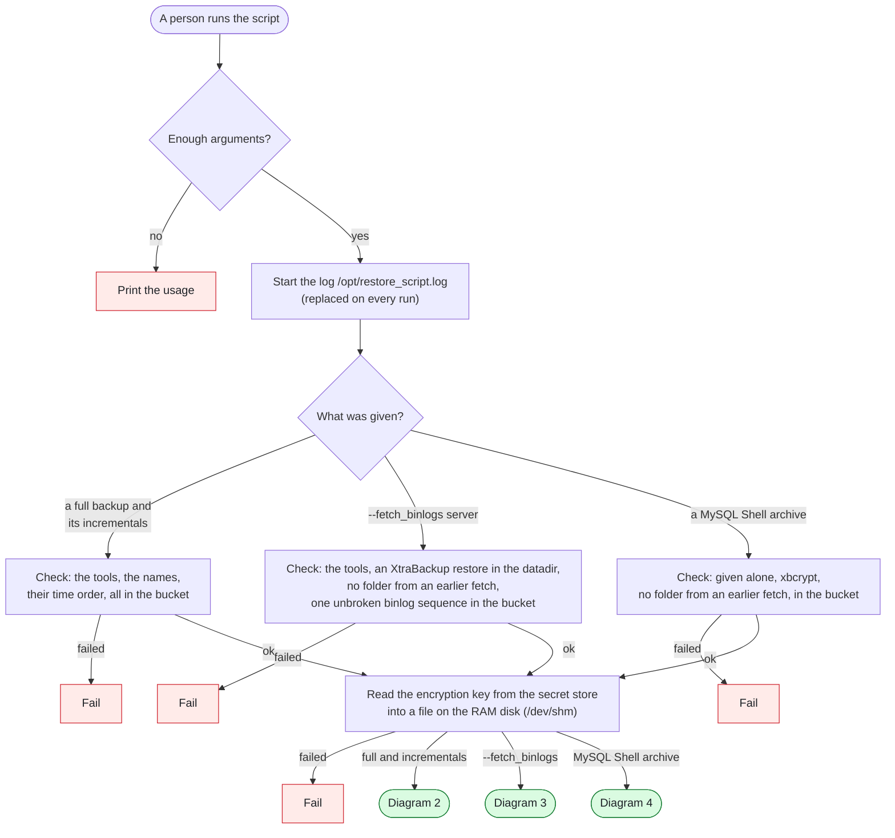
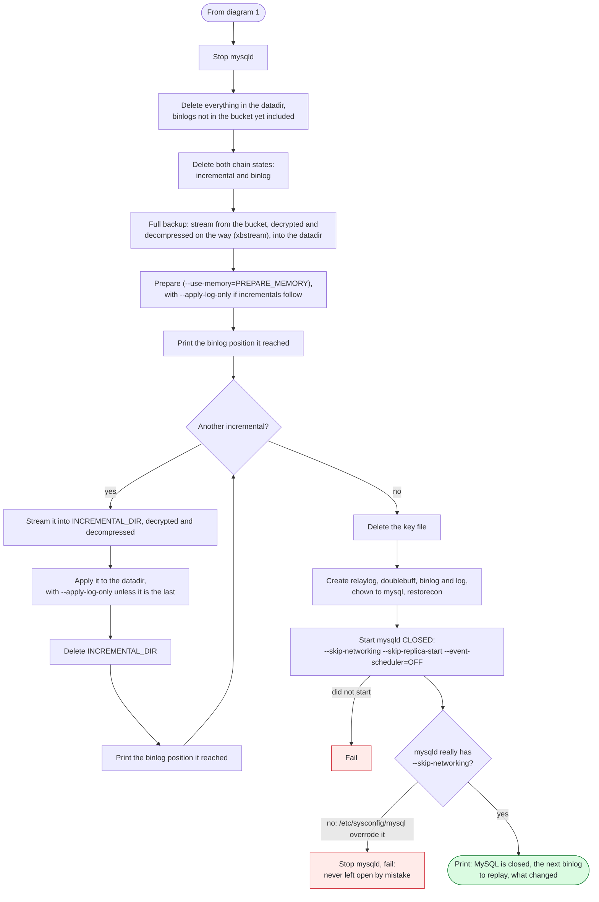
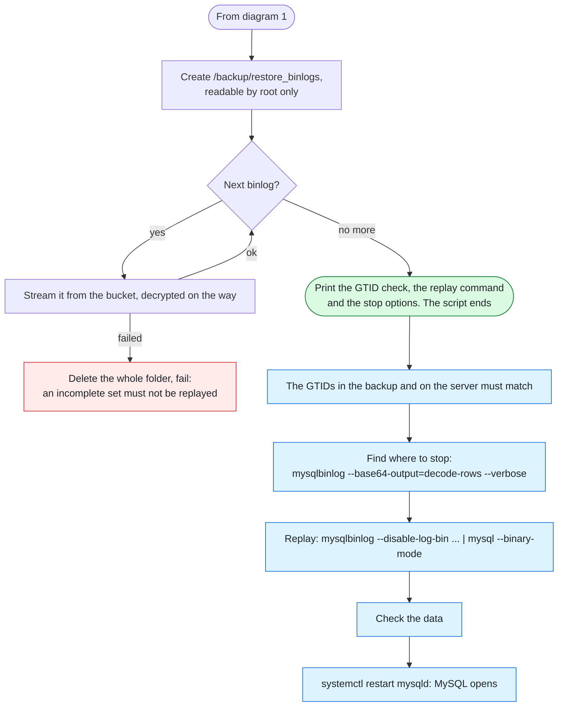
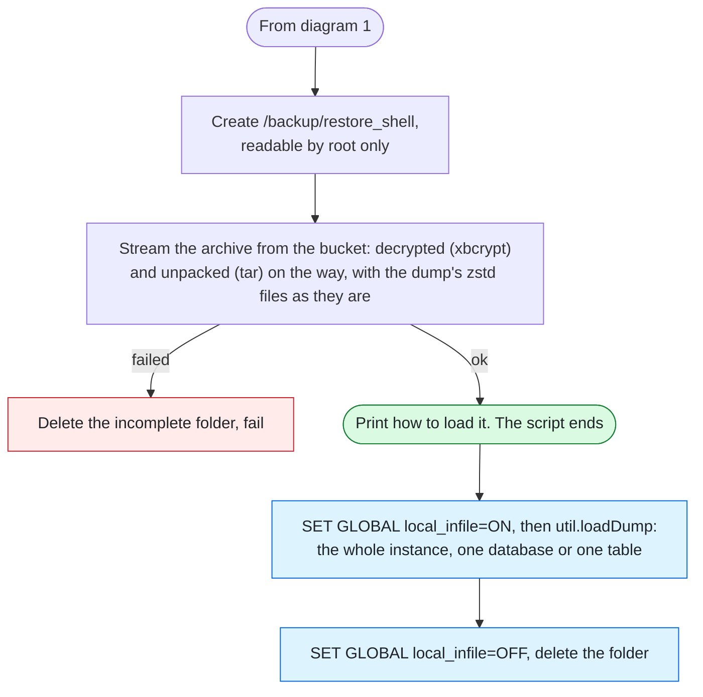

# MySQL restore script: workflow

How [`mysql_restore_v2.sh`](mysql_restore_v2.sh) (GCP) and [`mysql_restore_v2_aws.sh`](mysql_restore_v2_aws.sh) (AWS) work: the same logic, with different cloud commands. They restore the encrypted backups of [`mysql_backup_v3.sh`](../mysql_prod_backup_scripts/mysql_backup_v3.sh) and fetch the binlogs of [`mysql_binlog_backup_v2.sh`](../mysql_prod_backup_scripts/mysql_binlog_backup_v2.sh). [`mysql_restore.sh`](mysql_restore.sh) stays for the old unencrypted backups.

The diagrams leave the cloud out: **bucket** is the GCS or S3 bucket, and **secret store** is where the encryption key is kept (GCP Secret Manager or AWS Secrets Manager). What to set up before the first run is at the top of the script.

| Command | What it does |
|---|---|
| `mysql_restore_v2.sh <full> [<incremental> ...]` | **Replaces the datadir** with the backups, then starts MySQL closed to clients. |
| `mysql_restore_v2.sh --fetch_binlogs <server>` | After that restore: fetches the binlogs and prints how to replay them. MySQL is not touched, and a DBA runs the replay by hand. |
| `mysql_restore_v2.sh <archive>.tar.xbcrypt` | Fetches a MySQL Shell archive and prints how to load it. MySQL is not touched. |

## 1. One run

Red: the run ends with exit 1, and MySQL has not been touched.



The key file is removed however the script ends. The key is never printed or written to the log.

## 2. The XtraBackup restore

A failure from "Stop mysqld" on leaves MySQL stopped and the datadir incomplete. The script says so: fix the error and run it again.



Each incremental is extracted, applied and deleted before the next one, so `INCREMENTAL_DIR` never holds more than one.

Each step prints the position it reached, for example:

```
Full backup reached: mysql-bin.000150, position 4571 (backup ended 2026-11-02 03:12:44)
Incremental backup 1 of 2 reached: mysql-bin.000171, position 982 (backup ended 2026-11-03 01:40:10)
Incremental backup 2 of 2 reached: mysql-bin.000190, position 1337 (backup ended 2026-11-04 01:38:52)
Next binlog to replay (the restored data ends here): mysql-bin.000190, position 1337 (backup ended 2026-11-04 01:38:52)
```

The replay starts inside that same binlog, not the one after it.

## 3. Fetching the binlogs, and the replay by hand

Blue: a DBA does this by hand. The script ends before it.



- **Which binlogs:** from the binlog the restored data ended in, taken from the datadir's `xtrabackup_binlog_info`. So use it right after an XtraBackup restore: a server that has moved on since then still has the old file, and the GTID check shows the difference.
- **Which date folders:** from the day before the backup ended. Older folders can hold the same numbers from an old sequence.
- **Refused:** a missing number is a gap the replay can't cross, and a repeated one means two sequences.
- **Why on disk:** `mysqlbinlog` must read all the binlogs in one process, so they can't be streamed into the replay.

The stop options:

| Goal | Option |
|---|---|
| Everything fetched | No stop option |
| Stop at a time | `--stop-datetime="2026-11-04 14:32:00"`: the local time of the machine, and it stops at the first event at or after it |
| Stop just before a bad statement | `--stop-position=N`: it applies to the last file named, so name the files one by one, up to that file |
| Skip one bad transaction, keep the rest | `--exclude-gtids='uuid:N'`: only if later transactions do not depend on it |

## 4. Fetching a MySQL Shell archive



The archive holds the dump's binlog position in its `@.json`. `--fetch_binlogs` doesn't use it, so a replay after a MySQL Shell load is done by hand.

## A restore to a chosen moment, step by step

The GCP commands, on the same server. On AWS, use the `_aws.sh` scripts and `aws s3 ls`.

```bash
# 1. Save what is not in the bucket yet: the restore deletes the binlogs in the datadir.
#    With MySQL down, copy the binlog files off the datadir by hand instead.
/opt/scripts/mysql_binlog_backup_v2.sh --continuous_binlog_backup

# 2. Pause the backups, so none starts during the restore or the replay.
mv /etc/cron.d/mysql_backup /etc/cron.d/mysql_binlog_backup /root/

# 3. Choose the backups: the last one that ENDED before the moment, its full and every incremental up to it.
#    The names show when a backup started, but its data reaches its end.
gcloud storage ls --long --readable-sizes gs://BUCKET/ | grep -E 'xbstream|xbcrypt'

# 4. Restore. MySQL comes up closed.
/opt/scripts/mysql_restore_v2.sh 2026-11-02-020001-dbfull.xbstream 2026-11-03-020001-dbincr.xbstream 2026-11-04-020001-dbincr.xbstream

# 5. Fetch the binlogs of the server the backups came from. Copy in any binlog saved by hand.
/opt/scripts/mysql_restore_v2.sh --fetch_binlogs <server>

# 6. Check the GTIDs it printed, then replay. The script prints this command with the real position.
mysqlbinlog --disable-log-bin --start-position=1337 --stop-datetime="2026-11-04 14:32:00" /backup/restore_binlogs/mysql-bin.* | mysql --login-path=local --binary-mode

# 7. Check the data, then open MySQL and delete the unencrypted binlogs.
systemctl restart mysqld
rm -rf /backup/restore_binlogs

# 8. Start the new chains: a new full backup, then the binlog it starts from.
/opt/scripts/mysql_backup_v3.sh --xtrabackup
grep binlog_pos /opt/scripts/mysql_backup.state/xtrabackup_info
/opt/scripts/mysql_binlog_backup_v2.sh --init_binlog_chain mysql-bin.NNNNNN

# 9. Put the cron files back.
mv /root/mysql_backup /root/mysql_binlog_backup /etc/cron.d/
```

## What changes after an XtraBackup restore

| What | Why, and what to do |
|---|---|
| MySQL is closed to clients | Only the local socket works, with no replication and no scheduled events. `systemctl restart mysqld` opens it, and so does a reboot. |
| Both chains are stopped | The incremental and binlog backups fail, and alert, until a new full backup and `--init_binlog_chain`. Without this, an incremental would miss changes and the new binlogs would go into the old chain, both without any error. |
| A new binlog sequence | Whatever its numbers (`SHOW BINARY LOGS`), they can repeat names already in the bucket. The oldest binlog on the server is the backup's cut-off copy of an old one, so don't start the new chain from it. |
| New `server_uuid` | `auto.cnf` is not in the backup. |
| New TLS certificates | The `*.pem` files are not in the backup. Clients that verify the server need the new CA. |
| Replicas | `--disable-log-bin` keeps the replayed data out of the new binlogs, so replicas don't get it. Rebuild them from a new backup. |

## Limits

- **A restore to an older point:** the new binlog chain can reach names the old chain has in the bucket. Its upload then fails (it never overwrites), and a later `--fetch_binlogs` refuses two sequences with the same numbers. Move the old chain's binlogs from those numbers on out of the server's folder.
- **Replay speed:** `mysqlbinlog | mysql` applies one transaction at a time. Measure it on a real server before counting on it.
- **`PREPARE_MEMORY`:** too much can OOM the server, because xtrabackup can't use huge pages reserved for MySQL. Use about half of `MemAvailable`, checked with MySQL stopped.

## What it writes

| Where | What |
|---|---|
| The datadir | The restored backups, after deleting everything that was there |
| `/backup/restore_incremental` | One decompressed incremental at a time, deleted after it is applied |
| `/backup/restore_binlogs` | The fetched binlogs, **not encrypted**, readable by root only. A DBA deletes them. |
| `/backup/restore_shell` | The unpacked MySQL Shell dump, **not encrypted**, readable by root only. A DBA deletes it. |
| `/dev/shm/mysql_restore_key.*` | The key file, readable by root only, for the run only |
| `/opt/restore_script.log` | The last run, with colors (`less -R`). Each run replaces it, so `--fetch_binlogs` replaces the restore's log. |
| Deleted | `/opt/scripts/mysql_backup.state` and `/opt/scripts/mysql_binlog_backup.state`: the two chain states |
