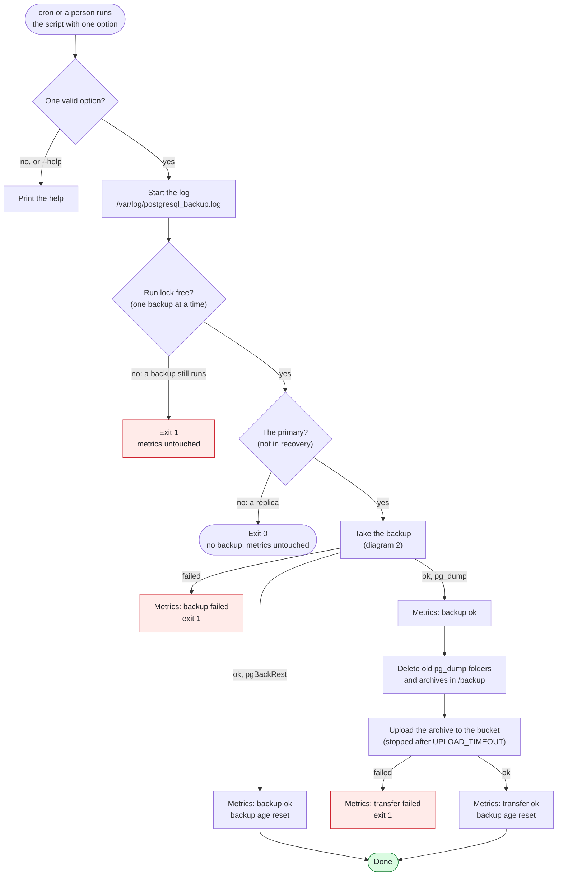
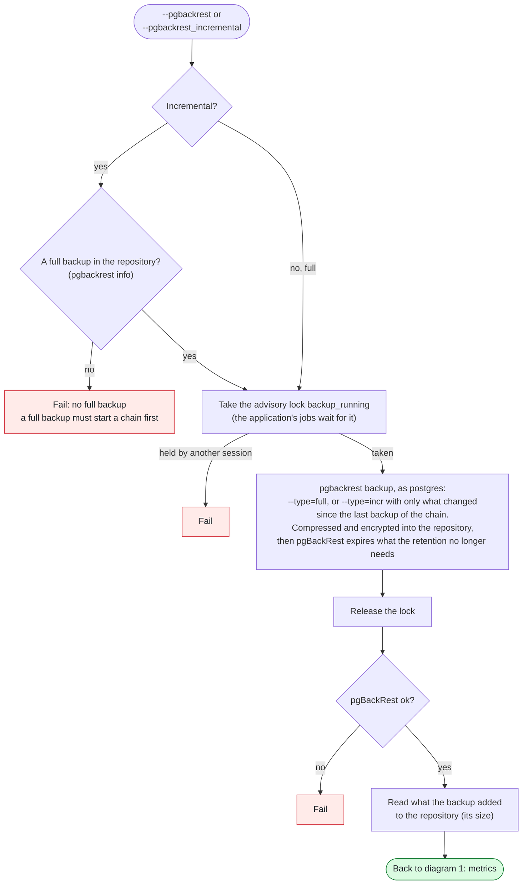
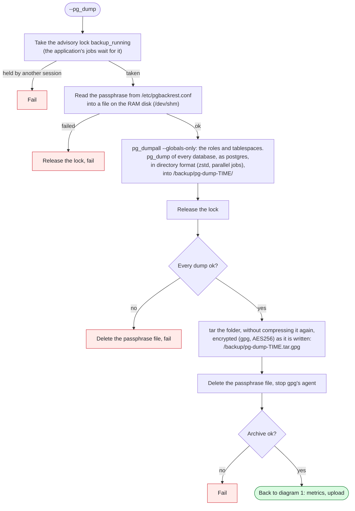
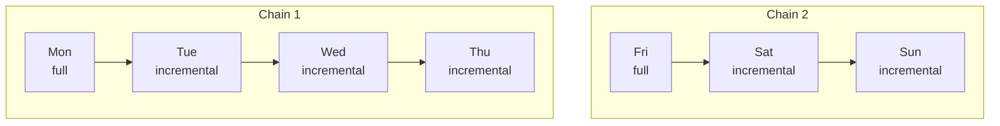

# PostgreSQL backup script: workflow

How [`postgresql_backup_v1_aws.sh`](postgresql_backup_v1_aws.sh) (AWS) works. The diagrams leave the cloud out: **bucket** is the S3 bucket, and **repository** is pgBackRest's folder in it.

| Option | What it does |
|---|---|
| `--pgbackrest` | A full physical backup with pgBackRest, compressed and encrypted, straight into its repository. It starts a new incremental chain. |
| `--pgbackrest_incremental` | Only what changed since the last backup of the chain, into the repository. |
| `--pg_dump` | A logical backup: every database and the roles, as an encrypted archive uploaded to the bucket. |
| `--pg_dump_local` | Only the backup step of `--pg_dump` (diagram 2): the archive stays in `/backup`, with no upload and no metrics. |

pgBackRest itself archives the WAL all the time (`archive_command`), so there is no WAL option here: the script takes the backups, and pgBackRest expires the old backups and WAL after each one.

## 1. One run

Red: the run ends with exit 1.



## 2. The backup step

pgBackRest, full and incremental. Each fail goes back to diagram 1 as "failed":



pg_dump. Each fail also goes back to diagram 1 as "failed":



If the script is interrupted during a backup, a trap deletes the passphrase file and releases the lock. The passphrase is never printed or written to the log.

## 3. The incremental chain



- Each incremental holds only what changed since the backup before it. pgBackRest keeps track of the chain in its repository (`backup.info`), so the script keeps no chain state of its own.
- Without a full backup an incremental fails: pgBackRest would take a full one instead, without being asked.
- A failed backup leaves nothing in the repository, so the next incremental continues from the last good one.
- A full backup starts a new chain. [The cron example](#cron) takes fulls on Monday and Friday, and incrementals on the other days.
- To restore: `pgbackrest --stanza=<stanza> restore` picks the backups of the chain and the WAL it needs. For a moment between backups: `--type=time --target="<time>"`.
- Retention: pgBackRest's `repo1-retention-full` in `/etc/pgbackrest.conf` (for example `time` and `7`: any moment of the last 7 days stays restorable). pgBackRest keeps the full backup a restore point needs and expires the rest, with its WAL. **Never put a bucket lifecycle rule on the repository's folder**: it would delete files pgBackRest still needs.

## Cron

`/etc/cron.d/postgresql_backup`, for fulls on Monday and Friday and incrementals on the other days:

```
PATH=/usr/local/sbin:/usr/local/bin:/usr/sbin:/usr/bin:/sbin:/bin
0 2 * * 1,5 root /opt/scripts/postgresql_backup_v1_aws.sh --pgbackrest > /dev/null 2>&1
0 2 * * 0,2,3,4,6 root /opt/scripts/postgresql_backup_v1_aws.sh --pgbackrest_incremental > /dev/null 2>&1
```

- **`PATH`:** cron's own is short. The script needs `runuser` (in `/usr/sbin`) and finds the AWS CLI with `which`.
- **Take the first full by hand before enabling it:** `/opt/scripts/postgresql_backup_v1_aws.sh --pgbackrest`. Otherwise every incremental fails with "No full backup" until the next Monday or Friday.
- **The output:** the script logs itself to `/var/log/postgresql_backup.log`, so cron's copy goes to `/dev/null`. pgBackRest's own detailed logs are in `/var/log/pgbackrest/`.
- **The file:** owned by root, mode 644, ending with a new line, and with no dot in its name, or cron ignores it. The script needs `chmod 700`.
- **The time:** the server's local time.
- **Long backups:** a run that finds another still running fails, with its metrics untouched.
- **pg_dump:** `--pg_dump` is not in the example. If you schedule it, pick a time that doesn't overlap the pgBackRest runs: both read the whole database.
- **Replicas:** the same file can sit on every server of the cluster. On a replica each run ends at once, without a backup.

## What it writes

| Where | What |
|---|---|
| Repository (bucket) | pgBackRest's backups and WAL, encrypted, expired by pgBackRest |
| Bucket, pg_dump folder | `pg-dump-TIME.tar.gpg`, encrypted. Its retention is a bucket lifecycle rule on that folder |
| `/backup` | Recent logical backups for a quick restore: the pg_dump folder (not encrypted) for a day or two, the archives for 3 days |
| `/var/log/postgresql_backup.log` | Every run, with colors (`less -R`) |
| node_exporter textfile folder | `node_postgresql_backup_*` (pgBackRest fulls), `node_postgresql_incremental_backup_*` and `node_postgresql_logical_backup_*` (pg_dump, with `_transfer_*`): status, duration, backup size (`_size_bytes`, after a successful backup), time of the last success |
